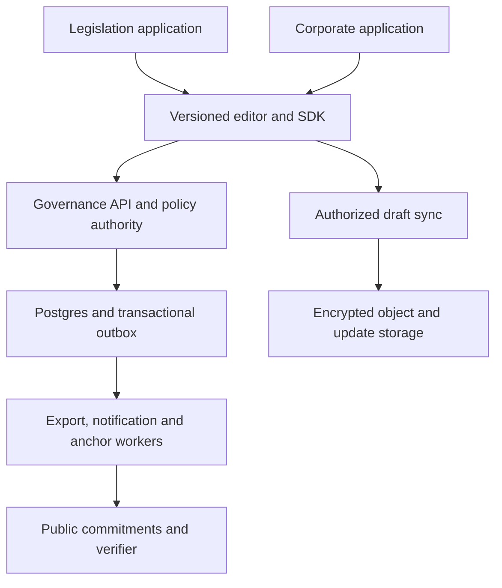

# Document collaboration platform: architecture and product specification

Prepared October 16, 2026 (America/New_York). Approved repository names are Distributed-Governance-Engine, CivicQuill and CharterQuill. The latter two are related branded hosted subscription products; white-label/custom deployments require bespoke agreements. This specification covers the requested full product. The accompanying commits implement an intentionally bounded foundation; future capabilities are not represented as working services.

## Existing products and build decision

The idea has meaningful predecessors. A current primary-source review found close components, but did not verify one product that supplies the complete requested combination. Absence from documentation is not proof a vendor cannot provide a feature privately or through customization.

| Product | Verified overlap | Difference from this brief |
| --- | --- | --- |
| Discuto | Document paragraphs, paragraph voting, voteable comments, editing, discussion, consensus meter and exports | Its documented workflow recommends preparing formatting elsewhere and describes editor changes with reset votes; documentation reviewed does not establish the full frozen-ballot policy, structured claim graph, corporate rights and independently verified anchoring workflow |
| OpenSlides | Line-based amendments, motion management, electronic votes, workflows, HTML editor and legal-friendly PDF exports | Assembly/motion focus; the reviewed product documentation does not establish this entire document-first ranked-argument and public/corporate product combination |
| Antragsgrün / motion.tools | Text amendments, one- or multiple-paragraph amendment permissions, configurable voting blocks, yes/no/abstain votes and automatic outcomes on closing | A strong amendment-system precedent; the documentation reviewed does not establish this complete general editor, trust, signatures and transparency architecture |
| Decidim | Participatory texts, proposals, amendments and history | Its documented amendment acceptance is by the original proposal author; that differs from automatic adoption under a frozen electorate/quorum policy |
| Kialo | Structured pro/con claims with relevance/impact ratings | Provides a useful argument model; the reviewed source is not a legal text adoption/editor workflow |

Build a focused engine using established editor/collaboration libraries rather than implement a word-processing stack from scratch. Do not claim novel invention, patentability or complete competitive uniqueness from this search. Do not copy vendor code or copyrighted assets without an appropriate license review. Existing Debate-Engine is oriented toward candidate video debates, so no hard dependency on its domain model is introduced. Assess reusable identity/audit/payment adapters separately; keep interfaces compatible without assuming those existing projects are production-ready.

Sources checked: https://www.discuto.io/en/basic-page/how-it-works ; https://openslides.com/en/functions/motions/ ; https://motion.tools/help/amendments ; https://motion.tools/help ; https://docs.decidim.org/en/develop/admin/components/proposals/special_configurations/amendments.html ; https://docs.decidim.org/en/develop/admin/components/proposals/special_configurations/participatory_texts.html ; https://support.kialo-edu.com/en/hc/about-voting/ . Claims above are limited to the described features.

## Three repositories and dependency direction

| Repository | Owns | Does not own |
| --- | --- | --- |
| Distributed-Governance-Engine | Semantic editor/UI packages, document model, identity capabilities, proposal lifecycle, voting/eligibility interfaces, argument graph, versioning, audit, verification, export/signing, settings, entitlements, SDK and service contracts | Jurisdiction-specific legislative workflow or company-specific governance interpretation |
| CivicQuill | Civic branding/routes, jurisdictions/templates, office verification, constituency adapters, public-input reports, legislative exports, research engagement, civic monetization configuration | A fork of the editor, crypto, tally or adoption code |
| CharterQuill | Organization/board/committee rooms, record dates, share/classes, proxies, reserved matters, consents/minutes, capacity and enterprise integrations | A fork of the editor, crypto, tally or adoption code |

The engine is a monorepo internally with versioned editor, domain, SDK and UI packages plus API/realtime/worker services. The two thin application repos consume exact engine package and API versions. Application-specific schema extensions use namespaced modules. The production application stack is TypeScript/React with a ProseMirror-based semantic editor and Yjs draft collaboration. The initial foundation uses dependency-free ESM JavaScript and Node's test runner so correctness contracts run without package installation; migration into typed packages is part of the editor/SDK work. There is no dependency on paid editor extensions.

Deploy initially as a modular service with separately scalable realtime and workers, rather than create dozens of microservices. Render services and Neon Postgres are the intended existing-project-compatible deployment targets, subject to actual costs, authorization and verified transport capabilities. A frontend can run on Sites when desired, but a private static demonstrator is not evidence of a working governance backend. No production services are created in this foundation.

## Differences between the two applications

| Concern | Legislation application | Corporate governance application |
| --- | --- | --- |
| Default weighting | One eligible person, one vote | Record-date voting units derived from shares and applicable class rights; board/committee profiles may use equal persons |
| What a vote means | Community adoption of draft wording, or advisory input to a sponsor | A configured organizational decision/consent; execution and legal effect are separately recorded |
| Eligible population | Public, invited, verified-person, constituency or residency cohorts | Directors, committee members, shareholders, members, beneficial owners and authorized proxies |
| Authority | Document steward/sponsor and disclosed public governance | Bylaws, charter, operating agreement, class rights and delegated management authority |
| Privacy default | Published civic documents are public; private preparatory drafts remain possible | Private encrypted workspace; explicit selective disclosures |
| Transparency | Public edition/proposal/decision provenance and periodic/final blockchain commitments required | Private audit always; public blockchain anchoring optional and off by default |
| Quorum | Known electorate quorum or open-public minimum support/verified-participant conditions | Represented voting weight or heads, record dates, class-specific quorum/approval and reserved matters |
| Proxy/delegation | Optional policy-defined delegation later; equal-person default | Authenticated proxy powers, custody/beneficial-owner attribution, revocation, split allocations and double-count prevention |
| Content access | Public deliberation with optional participant cohorts | Confidential clauses, scoped unlocks, committees, counsel access and expiration |
| Workflows | Sponsor source editions, public consultations, amendments, sponsor disposition and legislative handoff | Notices, agendas, meetings, written consents, board/member sequencing and execution packages |
| Conflict handling | Affiliation/funding disclosure, moderation, public challenge | Conflicts of interest, recusals, access restrictions and denominator treatment |
| Identities | Public pseudonyms with private eligibility evidence; verification tier shown | Verified authority/capacity without exposing cap-table or personal records |
| Research | Citations, thesis/class research, evidence collections and public explanations | Due-diligence attachments, confidential evidence, minutes and governance history |
| Analytics | Participation, verification coverage, constituent input and competing language; no claim of population representativeness | Exact weighted turnout, class approvals, quorum, proxy status, notices and closing records |
| Signatures | Opt-in support/attribution; separate official execution where applicable | Explicit execution intent and signatory capacity, not inferred from an approval vote |
| Exports | Legal numbering, bill text, redlines, constituent input, USLM/other profiles as implemented | Agreements/resolutions, signature evidence, minute books, class/proxy records and private archives |
| Retention | Public historical editions with privacy-aware correction/redaction procedures | Configured retention, legal holds, offboarding and encrypted archives |
| Monetization | Configurable creation subscription/credits/per-document/free allowance; verified official grants | Organization/seat/usage licensing and enterprise integrations using the same entitlement engine |
| Integrations | Office directory/verification, jurisdiction metadata and sponsor handoff | SSO/SCIM, cap tables, custody/proxy sources and signing providers |

Software does not create a shareholder voting right by selling a share or enabling a setting. It records and enforces the configured governing entitlement. Likewise, community adoption does not introduce, pass or enact legislation. Those labels must remain distinct in product copy and exports. No jurisdiction-complete legal validity engine is promised.

## Essential editor features

| Priority | Features and purpose |
| --- | --- |
| Core drafting | Paragraphs/headings; bold/italic/underline/strike; limited fonts and sizes; alignment/spacing; bullets; simple tables; links; copy/paste; find/replace; undo/redo; autosave/recovery; spellcheck; word counts; accessible keyboard controls |
| Legal structure | Jurisdiction-aware nested numbering, stable section IDs, outline move/indent/outdent, reserved sections, continuation/restart, defined terms, schedules/exhibits/annexes, cross-references, citations, footnotes/endnotes and broken-reference warnings |
| Legal numbering default | Federal profile: section → (a) → (1) → (A) → (i) → (I). Do not treat this as universal; state/corporate profiles can choose a different order. Stable references bind IDs rather than displayed labels |
| Collaboration | Selection-to-replacement proposal; insert/delete/move; atomic multi-clause amendments; semantic redlines; branches/drafts; presence for bounded editor rooms; proposal/point attribution; competing alternatives; stale/conflict resolution; deliberate finalization |
| Deliberation | Clause-linked drawer with proposed language, concise pro/con/evidence points, counterclaims, up/down point votes, best/new/controversial sorts, independent decision ballots, clear quorum and deadline progress |
| Document integrity | Immutable adopted editions; restore as new edition; proposal/policy/electorate/ballot binding; receipt history; readable verification status; audit and comparison tools; signing invalidation on text changes |
| Print and delivery | Page size/margins, headers/footers, page/line numbers, page breaks, keep-with-next, widow/orphan controls, cover pages, bookmarks/TOC, footnote layout, embedded licensed fonts, accessible tagged PDF and selectable text |
| Portable exchange | DOCX/plain text/HTML/JSON; ODT import if converter validation passes; structured legislative XML adapters. PDF import is extraction/OCR into a reviewed draft and cannot claim exact structure from arbitrary PDFs |
| PDF-oriented functions | Final frozen PDF, PDF/A profile with validation, redline export, evidence certificates, digital signatures, timestamps/provider adapters, attachments/exhibits, irreversible redaction and verification QR/links |
| Signing | Natural ink via pointer/touch, typed name in licensed signature fonts, safely sanitized uploaded mark, explicit intent/capacity/consent, signing order, receipts and separate support vs execution workflows |
| Mass signing | Readable paginated appendices, searchable opt-in signer directory, downloadable full manifest, fixed-edition Merkle inclusion receipts and detached appendices; small signatures are optional within a legible minimum |
| Administration | One typed settings surface for roles, governance, privacy, anchoring, prices, quotas, grants, moderation, import/export and signing profiles, with scope inheritance and audit |
| Deliberately excluded initially | Drawing suite, slide designer, spreadsheet engine, macros, general desktop publishing, arbitrary active embedded objects, complex page art and a full desktop Word clone |

Bold and italic are straightforward presentation marks; fonts are normally TTF/OTF/WOFF assets, not TIFF images. Font identity and rendering version belong in export manifests because pagination and glyph availability matter for legal artifacts.

Tycho's Elegy is an explicit requested signature option in the font registry, disabled until web embedding, commercial use and PDF embedding/redistribution permissions are established. No unlicensed font bytes are bundled. The designer's website identifies the font: https://www.pia-frauss.com/fonts/te.htm ; commercial terms must be confirmed with the current rights holder. License-free fallback choices need their own recorded licenses; do not silently substitute another font under Tycho's name. A visible ink mark is separate from cryptographic signature authentication. Preserve intent, identity assurance, exact content and retained evidence; do not promise universal enforceability. Relevant statutory source: https://uscodeweb1.house.gov/view.xhtml?edition=prelim&path=%2Fprelim%40title15%2Fchapter96 .

## Document, proposal and decision lifecycle

Draft text is mutable only by authorized draft authors. CRDT operations belong to draft branches. Published/adopted editions are immutable snapshots. A proposal binds document/tenant IDs, base edition, stable target IDs, selected quote/context, structural operations, replacement text, proposal revision and content digest. A ballot binds the exact proposal revision, electorate commitment and policy commitment. Changing wording, authority or material conditions creates a new proposal/ballot snapshot; votes are never silently carried forward.

Proposal states: draft → discussion → voting → closed-passed/closed-failed/advisory, with withdrawn, challenged, superseded and conflicted states. A passed proposal is not an adopted revision until the authoritative transaction verifies expected base, authorization, constraints and certificate and appends the next revision. Signing/finalization is a separate frozen edition state. An adopted revision is not automatically a legally executed agreement or enacted law.

Collaboration mode can adopt language once a configured final decision permits it. Public-input mode has no adoption threshold or canonical write action. It preserves proposals, point votes, decision/advisory polls, rankings and sponsor responses. Its original source edition never changes; a sponsor wanting a different source opens a separately identified edition/consultation. The API, worker and storage transition rules enforce this independently of UI controls. Active consultations cannot silently switch modes.

Overlapping accepted proposals are serialized. The first may adopt; the second fails its exact-base check and enters conflict review. A new rebased wording must be shown and voted on; no hidden merge changes voted meaning. Non-overlapping rebase automation is a future explicit policy that requires certified unchanged semantics and participant-readable lineage; default is conservative exact-base checking. Atomic amendment bundles either all apply or none apply.

## Voting mathematics and trust

Every decision policy names: electorate type and snapshot, voting units, quorum basis, approval basis, strict/inclusive comparison, minimum support, ballot replacement rules, open/close times, minimum deliberation, challenge/cooldown, finality, conflicting-alternative rules, class requirements and observer privacy. Display raw yes/no/abstain weights and distinct-person counts, with the precise denominators.

For a known electorate, quorum can be a headcount/weight floor or fraction of eligible heads/weight. A strict majority among decisive votes means yes > no, provided quorum and minimum yes support are met. Abstentions may count for quorum and may or may not belong in the approval denominator: that is an explicit policy setting. Empty turnout cannot pass. A two-thirds-at-least rule uses integer cross multiplication; do not compare rounded percentages.

Represent all voting units as canonical decimal integer strings and compute with arbitrary-precision integers. Fractional shares use a fixed declared scale at record date. Share class voting multipliers and required class approvals are independent from economic share counts. The policy must not conflate them. Snapshot identity is immutable and digest-bound. Ballot clients cannot supply their own weight. Proxies and direct voting cannot allocate the same entitlement twice.

For an open public population there is no meaningful known-population quorum percentage. Use an explicit absolute verified-person/support floor plus participation, approval, deliberation and anti-abuse conditions. Freeze the policy and admission rules at opening, append admitted eligibility credentials with receipts, then freeze the admitted electorate at closure. A changing population does not authorize changing voting weights retrospectively. Open participation without proof of personhood cannot guarantee one human one vote; verification tiers and limitations must be visible. The foundation deliberately supports frozen electorates only; the open-admission protocol is future DCE-011 work.

Argument votes rank points. Decision votes authorize a proposal outcome. Reputation governs anti-abuse privileges and optional discovery filters, not civic voting weight. Provide top pro and top con points, plus new/minority discovery and the ability to inspect chronological history. Net up/down ranking is transparent; confidence-aware sorting may be selected with its formula displayed. Avoid describing popularity as truth or inferring consensus solely from a positive net score. Moderation and reputation changes have appealable audit events; disagreement alone is not abuse.

## Unified settings and monetization

Maintain a schema-defined parameter registry with type, range, scope, default, source, mutability, effective time and invariant classification. Effective settings resolve platform → product → organization → document, with explicit non-overridable invariants. The unified admin has role-aware views for platform staff, organization admins, secretaries, sponsors and document stewards. Every change is validated, simulated and versioned; rollback creates a new configuration version. Active votes retain their old policy until closed/restarted under an explicit procedure.

Settings include: modes; allowed trust tiers; quorum/approval/deadline profiles; point-ranking controls; anti-abuse limits; organization privacy; anchor chain/cadence/finality/spend limits; signing/export/fonts; subscription/credit/package/weekly quotas; elected-official grants; role capabilities; integrations; retention and notification preferences. No admin can disable public anchoring, make public-input mutable, rewrite signed content, weaken cryptographic invariants, or bypass frozen voting rules.

Separate entitlements from payment providers. Grants may come from subscription, a single-document purchase, purchased credits, a configurable free weekly creation allowance, an administrator or sponsored/verified office. A grant has subject/scope/resource/action, quantity or unlimited status, effective/expiry time, provenance and audit. The example legislation profile offers one free created document per week as a configurable candidate policy. The creator pays; reading, discussing and voting are free by default. Existing lawful participation must not be removed because an author's subscription expires.

Credit/quota reservations are transactional and idempotent. Define what counts as a new document, copy, archived document, failed creation and reopened edition. Do not count each public-input suggestion as a paid document. Payment webhook IDs and immutable ledger entries prevent double credits/refunds. Provider adapters can be replaced without changing eligibility/governance. Verified US federal/state/local elected officials and authorized staff can receive unlimited legislative-purpose grants; configurable caps/heavy-use review can lead to an explicit paid offer, never an automatic charge. Private proof of office and term expiration are separate from public badges. No price or payment provider is fixed in code.

## Storage, APIs and consistency

Postgres holds tenants, identities/references, capabilities, document indexes, immutable revision metadata, proposal metadata, policy versions, electorate snapshots/admissions, encrypted content locators, ballots/history, point graphs/votes, reputation events, decision certificates, audit/outbox, anchor batches, signature intents/receipts and entitlement ledgers. Public content may be stored plainly after intentional publication; private payloads remain client encrypted. Tenant-scoped keys/foreign keys and tested RLS are defense in depth; a service account with bypass privileges must not be used for ordinary requests. See https://www.postgresql.org/docs/current/ddl-rowsecurity.html .

Use HTTPS command APIs for document/proposal creation, ballot replacement, closure, adoption, signing and admin. Require authenticated principal/capability, exact resource version, idempotency key and validated bounded payloads. WSS/SSE updates are projections emitted after commit through an outbox; consumers deduplicate event IDs and reconnect by sequence or full snapshot. Realtime is not ballot authority. No broadcast is an acknowledgment before commit. Workers use scoped credentials, per-tenant limits and idempotency; durable database jobs/outbox remain authority even when a cache/fanout service fails.

Core endpoint families: /documents and /editions; /proposals and /proposal-revisions; /policies and /electorates; /ballots and /decisions; /points and /point-votes; /exports and /signatures; /verification and /anchors; /settings, /entitlements and /audit. Publish OpenAPI/error contracts and consumer fixtures before thin apps integrate. Public-input documents have no successful adopt transition regardless of endpoint caller. Adoption uses serializable transaction or row/version lock with expected digest and uniqueness of decision application. Event partitions have ordered sequences within the authority domain, not an invented global ordering of every user action.

## Private encryption and public transparency

Inventory all trust boundaries: participant device/local cache; CDN/edge; authentication; API; realtime relays; database; queues; storage; backups; export/search; mail/payment vendors; telemetry/operators; signing service and chain RPC. Verify actual TLS and peer authentication on each applicable hop; a private network alone is insufficient. Application E2EE remains independent of transport termination. Pin upstream profiles/libraries and evidence; never implement an ad hoc messaging cipher.

Private organization content is decrypted only at authorized participant endpoints. Private draft updates, proposals, argument text, attachments and signature marks remain encrypted through relays, stores and backups. Server-side private search/OCR/rendering is unavailable by default; run at authorized clients, or use an explicitly disclosed authorized processing endpoint with a separately assessed boundary. A server KMS may protect infrastructure secrets/metadata, not unwrap application E2EE content. Sharing/export and deliberate publication are explicit disclosure events with recipient scope. A removed participant may retain old plaintext; do not promise recall.

For private adoption, the governance service can certify eligibility/tallies and a commitment to proposed wording without seeing its plaintext. An authorized endpoint applies deterministic content operations, validates the legal tree and produces an encrypted next edition plus signed transition manifest. Other authorized clients verify the exact plaintext transition and decision bindings before trusting that edition; the service's single revision sequence orders competing transitions. Production must define canonical content commitments, authorized-device signatures and malicious coordinator handling using audited components. If no authorized endpoint is online, adoption can queue; the service must not decrypt content as a convenience. This is designed work, not implemented E2EE in the foundation.

Public document text is intentionally disclosed, so content confidentiality against the public is not claimed for it. Private identity proofs, contacts, hidden votes and signature ink do not become public merely because a document is public. Public transparency means reproducible content/decision provenance and verifiable commitments, with explicit ballot privacy and disclosure scopes. Secret ballots and public person-to-ballot attribution are incompatible profiles; choose visibly. A publicly readable blockchain is not a place for plaintext, personal information, signature images, private cap tables or keys.

The upstream E2EESA development revision is d916938cb6b0e6569edfde88555984ddacb96021. Mapping is document-level design only; no certification or requirement-complete conformance claim is made. Its ciphertext-only infrastructure profile has bounded retention rules; long-lived legal records require separately assessed endpoint archive/backup profiles rather than quietly overriding those rules. The owner's instruction defers independent human review until completed deployment. Perform source-bound AI review/tests, fix actual findings and retain honest pending certification state; do not let absence of external review stop implementation.

## Hashes, anchoring and independent verification

Use a versioned canonical semantic document representation, independently specified canonical bytes and domain-separated cryptographic hashes. Bind exact content, schema/render profile where applicable, previous edition digest, proposal/decision/policy/electorate commitments and release identity. Canonical JSON ordering and Unicode/number handling need cross-language golden vectors. The foundation's restricted development canonicalizer is explicitly dce-c14n-v0-dev, not a claim of a complete standard implementation or permanent wire contract.

Public event logs issue signed receipts and form batched Merkle roots. Store leaves, checkpoint signatures, inclusion/consistency proofs, source manifests and chain receipts in portable archival packages. Anchor periodically by configurable time/batch count and on finalization. One transaction can commit many documents/events. Public documents cannot opt out; organization documents default off. Private anchoring uses appropriately blinded commitments to limit guessing and metadata correlation. A final artifact requiring an anchor is not shown as fully anchored until configured finality is observed. Offline/pending work can continue and is labeled pending, with no fictional receipt.

The anchor adapter specifies chain/network ID, payload encoding, contract/address if applicable, RPC verification, finality/reorg handling, fees/spend limits and signing authority. Select a production chain only after comparing fee, archival availability, finality and deployment conditions; do not hardcode a paid chain or pretend an L2 sequencer receipt has final public-chain settlement. Retries are durable/idempotent and capped; unavailable funds/RPC leave visible pending status. Merkle evidence and verifier must remain portable if the application disappears.

A chain commitment proves the relationship between disclosed bytes and an observed commitment under its consensus assumptions. It does not prove factual truth, legal authority, voter uniqueness, completeness or censorship resistance by itself. Signed submission receipts, append-only sequence rules, independent witnesses and client monitoring address omitted records and split views. An independent browser/CLI verifier checks content/artifact digests, edition transitions, cryptographic signatures, proof paths and real chain receipts; it reports limited/unverified states for missing material. Avoid marketing absolute trustlessness.

## Signatures and legal artifacts at scale

Separate (1) support for a bill, (2) approval of a proposal and (3) legal execution of an agreement. Each has different intent, authority, consent and privacy. Capture typed/drawn/uploaded visual marks as presentation, and bind the authenticated signing event cryptographically to the exact frozen edition and signing manifest. Identity assurance, authentication, signer capacity, consent text/version, timestamp, method, revocation/dispute and retained evidence are independently recorded. Do not infer an execution signature from an upvote.

Generate one immutable base artifact. Large signer sets use detached signed manifests and separately hashed appendix volumes; a core document should not be modified after each signature. If a jurisdiction/provider requires incremental PDF signature updates, preserve exact signed byte ranges and certified allowed changes. A content hash and PDF/render hash are distinct. Signers must see the edition/artifact they assent to. Any later wording creates a new edition and new assent. Revocation/dispute is a new event and cannot erase a historical commitment.

A million handwriting images need not be embedded in a huge PDF. Offer readable paginated signature volumes, compact summaries with count/root, a downloadable full manifest and an individual inclusion receipt. Full signature volumes can still be generated as bounded streaming jobs with legible minimum size. Visibility of names and ink is opt-in where appropriate. Redaction is an explicit derived artifact with removed underlying text/metadata, its own digest and a preserved provenance statement; signing/anchoring old material cannot be undone.

## Walkthrough and interaction design

The primary surface has a left outline, readable legal document in the center and a right slide-out proposal/discussion drawer. Selecting text opens Suggest replacement, shows before/after and a concise rationale field. Opening a proposal shows strongest pro/con points with citations, separate point-vote arrows, and a clearly distinct yes/no/abstain ballot. Quorum/deadline/trust tier and exact edition are always inspectable. Public-input mode says source text stays fixed and never offers automatic adoption.

Anchored tour: document mode → legal outline → select text → replacement preview → structured points → point ranking → decision ballot/rules → edition history/verification → signatures/export → scoped admin. Balloon targets use stable data-tour IDs, follow scroll/resize, avoid covering the focused control, support keyboard next/back/close, announce step counts and restore focus. Missing targets are skipped with a safe explanation; role/mode variants never reveal unauthorized features. Save completion/version locally and allow restart; tours do not cast real votes. The foundation includes an in-memory tour demonstrator, not a production editor or persistence substitute.

## Scaling and the solar-system objective

Separate millions of read-only viewers from limited draft editor rooms and from partitionable proposal/ballot/argument traffic. Cache immutable public editions at the edge; use cursor pagination, virtualized point lists, proposal-scoped fanout and section subdocuments. Partition by tenant/document/proposal and later voting shards; aggregate projections asynchronously. Preserve a single authoritative edition sequence per document and deterministic frozen decision input. Do not make all participants load every point, signature, CRDT update or voter identity.

Stage capacity targets to measure, not claims: 100 concurrent draft editors/document, 10,000 active voting users on a hot bill, 1 million stored ballot records, and 10 million public reads/day under a declared infrastructure/cost budget. Benchmark overload and p95 latency, reconciliation, queue lag and recovery on real deployments before advertising limits. Search, signature exports and anchoring are asynchronous bounded jobs. Use backpressure, fair tenant quotas and explicit failure states; no unlimited-work feature bypasses safety/resource budgets.

An interplanetary deployment cannot have instantaneous synchronous consensus across arbitrary distances. Future federation uses per-document authority/finality domains, signed portable snapshots, delayed/offline submissions, durable queues and explicit arrival deadlines/grace rules. Participants know which domain orders votes and when a received ballot is final. Simulate partitions and minutes/hours of delay before any larger claim. Federation is a planned later capability, not a reason to delay the first useful terrestrial product.

## PR plan, verification and completion states

There are 39 core engine units, 14 legislation units and 14 corporate units: 67 planned PR specifications. They are stored in each repo's registry/prs.json and detailed docs/prs/*.md. This is an initial comprehensive decomposition, not a guarantee the total will never change; add discovered work without hiding scope changes. Unit IDs are not GitHub PR numbers. Initial bootstrap commits have no PR mappings and no accepted units.

The shared registry contract is copied from the real Boardroom implementation. Validate all local and cross-repo dependency IDs, prohibit cycles, preserve explicit mapped PRs and distinguish contributions from completion. Exact-head CI and the vendored GitHub merge preflight are mandatory before authorized merges; no tests/pending/skipped/capacity failures are not success. Remote source and actual GitHub state own PR facts. Engine Room/Boardroom discovery is unverified until a real authenticated synchronization acknowledges these repositories and imports the current plan.

Foundation verification covers pure domain rules, profiles, numbering, development canonicalization/Merkle proofs, registry compatibility and honest security status, with deterministic adversarial/property cases. It does not test a database transaction, real authentication, E2EE, rich editor/browser workflows, real signing, payments, anchoring, deployment or production capacity. Later PRs require appropriate unit/integration/security/accessibility/migration/browser/load/recovery suites and source-bound evidence. New tests must exercise behavior and failure modes, not mirror implementation.

Status vocabulary: designed, implemented, locally tested, CI verified, merged, deployed, live verified, operationally accepted, independently reviewed, certified. Never collapse them. The owner's requested human review happens after completed deployment; no human review approval is added as a preliminary development/release gate. Credential availability, real vulnerabilities, failed required checks and unauthorized costs remain concrete issues to resolve without fabricating success.

## Foundation publication

The owner created three public source repositories and authorized development on October 16, 2026. The foundation is being published through real pull requests under the approved names. See registry/prs.json for actual PR mappings and security/integration-status.json for verified repository identity. Public source publication does not constitute production deployment, live dashboard registration, or independent security review.

See PRODUCT_DIRECTION.md for the approved hosted subscription and brand relationship. Custom branding/deployment remains an architectural extension used through bespoke agreements, rather than the normal product delivery model.
